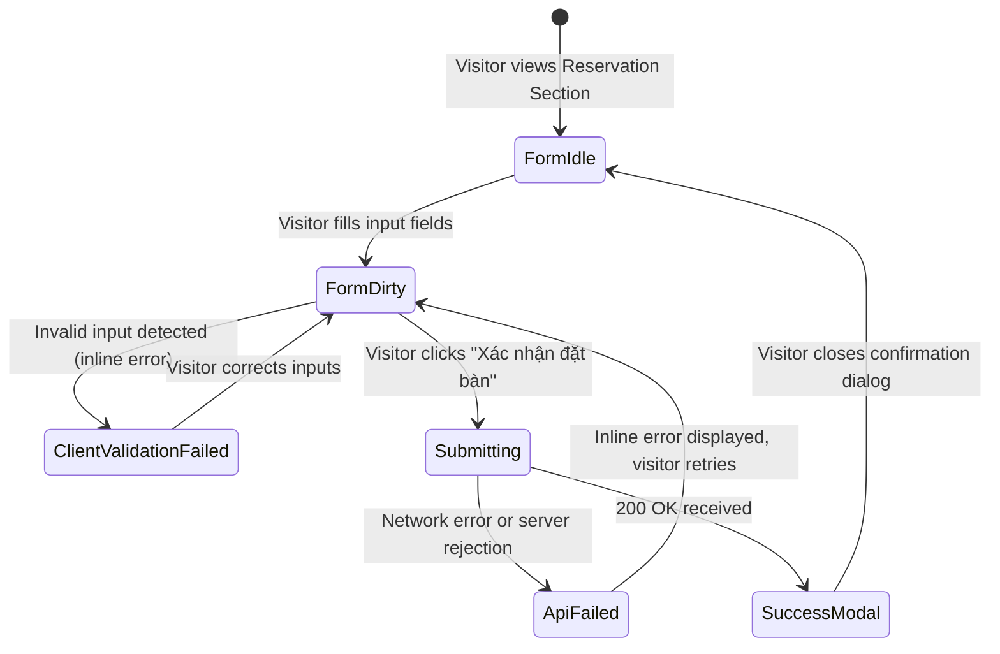

# Data Model: Bon Vivant Bistro Landing Page

**Feature**: `001-bon-vivant-landing`  
**Date**: 2026-10-11  
**Status**: Ready  

---

## 1. Entities & Types

### 1.1. Menu & Categorization

```typescript
export type MenuCategoryId = 'appetizers' | 'mains' | 'desserts' | 'wine';

export interface LocalizedString {
  vi: string;
  en: string;
}

export interface MenuItem {
  id: string;
  categoryId: MenuCategoryId;
  name: LocalizedString;
  description: LocalizedString;
  priceVnd: number;
  imageUrl?: string;
  badge?: LocalizedString; // e.g. "Signature", "Món đặc trưng", "Chef's Choice"
  dietary?: ('vegetarian' | 'gluten-free' | 'contains-nuts' | 'alcohol')[];
  featured?: boolean;
}

export interface MenuCategory {
  id: MenuCategoryId;
  title: LocalizedString;
  description?: LocalizedString;
  order: number;
}
```

### 1.2. Restaurant Profile & Operations

```typescript
export interface ServiceShift {
  name: LocalizedString; // e.g., "Bữa trưa / Lunch", "Bữa tối / Dinner"
  open: string;          // "11:30"
  close: string;         // "14:30"
}

export interface DaySchedule {
  dayOfWeek: string;     // Localized or key (e.g., "Thứ Hai - Thứ Bảy")
  shifts: ServiceShift[];
  isClosed?: boolean;
}

export interface RestaurantProfile {
  name: string;
  tagline: LocalizedString;
  storyTitle: LocalizedString;
  storyParagraphs: LocalizedString[];
  chefName: string;
  chefTitle: LocalizedString;
  chefBio: LocalizedString;
  chefImageUrl: string;
  address: {
    street: string;
    ward: string;
    district: string;
    city: string;
    fullFormatted: string;
    mapEmbedUrl: string;
    googleMapsDirectionsUrl: string;
  };
  contact: {
    hotline: string;
    email: string;
    social: {
      facebook?: string;
      instagram?: string;
      zalo?: string;
    };
  };
  schedules: DaySchedule[];
}
```

### 1.3. Gallery & Testimonials

```typescript
export type GalleryCategory = 'all' | 'culinary' | 'ambiance';

export interface GalleryItem {
  id: string;
  title: LocalizedString;
  category: 'culinary' | 'ambiance';
  imageUrl: string;
  aspectRatio: 'square' | 'portrait' | 'landscape';
}

export interface Testimonial {
  id: string;
  quote: LocalizedString;
  authorName: string;
  authorRole: LocalizedString; // e.g. "Thực khách thân thiết / Regular Diner"
  rating: number;              // 1 to 5 stars
  avatarUrl?: string;
  date?: string;
}
```

---

## 2. Reservation Form Validation & Schemas

### 2.1. Zod Validation Schema

```typescript
import { z } from 'zod';

export const reservationFormSchema = z.object({
  fullName: z
    .string()
    .trim()
    .min(2, { message: 'Họ và tên cần ít nhất 2 ký tự / Full name must be at least 2 characters' })
    .max(100, { message: 'Họ và tên quá dài / Full name too long' }),
  phoneNumber: z
    .string()
    .trim()
    .regex(/^(0|\+84)[3|5|7|8|9][0-9]{8}$/, {
      message: 'Số điện thoại không hợp lệ / Invalid phone number format',
    }),
  email: z
    .string()
    .trim()
    .email({ message: 'Địa chỉ email không hợp lệ / Invalid email address' }),
  date: z
    .string()
    .regex(/^\d{4}-\d{2}-\d{2}$/, { message: 'Ngày không hợp lệ (YYYY-MM-DD)' })
    .refine((val) => {
      const selected = new Date(val);
      const today = new Date();
      today.setHours(0, 0, 0, 0);
      return selected >= today;
    }, { message: 'Ngày đặt bàn không thể trong quá khứ / Date must be today or in the future' }),
  time: z
    .string()
    .regex(/^([01]\d|2[0-3]):([0-5]\d)$/, { message: 'Giờ không hợp lệ / Invalid time format' }),
  partySize: z
    .number()
    .int()
    .min(1, { message: 'Số khách tối thiểu là 1 / Minimum 1 guest' })
    .max(20, { message: 'Nhóm trên 20 khách vui lòng gọi hotline / Groups over 20 please call hotline' }),
  specialNotes: z
    .string()
    .max(500, { message: 'Ghi chú tối đa 500 ký tự / Notes maximum 500 characters' })
    .optional()
    .default(''),
});

export type ReservationFormData = z.infer<typeof reservationFormSchema>;
```

### 2.2. API Payloads

```typescript
export interface ReservationApiRequest extends ReservationFormData {}

export interface ReservationApiResponse {
  success: boolean;
  message: string;
  bookingRef?: string;
  errors?: Record<string, string[]>;
}
```

---

## 3. Reservation State Lifecycle



### Lifecycle States:
1. **Idle**: Empty or default initial form state (current date, default party size = 2).
2. **Validating**: Real-time / on-blur validation using React Hook Form + Zod resolver.
3. **Submitting**: Submit button displays loading spinner, inputs disabled to prevent double-click.
4. **Success**: Form resets; confirmation view presents booking summary and notifies guest that staff will call within 15–30 minutes.
5. **Error**: Inline error alert displayed with hotline link for immediate assistance.
