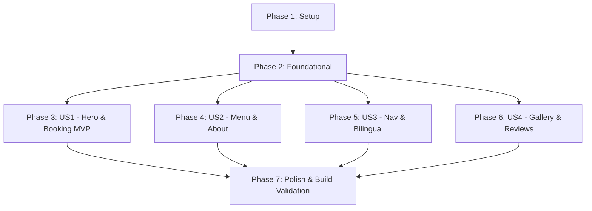

# Tasks: Bon Vivant Bistro Landing Page

**Feature**: `001-bon-vivant-landing` | **Date**: 2026-10-11 | **Spec**: [spec.md](./spec.md) | **Plan**: [plan.md](./plan.md)

---

## Phase 1: Setup (Shared Infrastructure)

**Purpose**: Initialize Next.js 15 App Router project with TypeScript strict mode, Tailwind CSS design tokens, and core dependencies.

- [x] T001 Initialize Next.js 15 App Router project with TypeScript and Tailwind CSS in repository root (`package.json`, `tsconfig.json`, `tailwind.config.ts`)
- [x] T002 [P] Install core runtime dependencies (`framer-motion`, `react-hook-form`, `@hookform/resolvers`, `zod`, `resend`, `lucide-react`, `clsx`, `tailwind-merge`) in `package.json`
- [x] T003 [P] Configure Tailwind CSS design tokens with ratified palette (Bordeaux `#6B1E2E`, Cream `#FDFBF7`, Cream Tint `#F5EFE4`, Gold `#B8975A`, Espresso Text `#2A1A1D`, Muted Text `#6B5A5D`) in `tailwind.config.ts`
- [x] T004 [P] Configure global CSS with smooth scrolling behavior, CSS custom variables, and typography defaults in `src/app/globals.css`
- [x] T005 [P] Configure Google Fonts (Playfair Display for display headers and Lora for body copy) using `next/font/google` in `src/app/layout.tsx`

---

## Phase 2: Foundational (Blocking Prerequisites)

**Purpose**: Establish core data contracts, Zod schemas, localization dictionaries, static data stores, and shared UI primitives before implementing any user story.

**⚠️ CRITICAL**: No user story phase can begin until this foundational phase is complete.

- [x] T006 [P] Define core TypeScript data models and interfaces (`MenuItem`, `MenuCategory`, `RestaurantProfile`, `Testimonial`, `GalleryItem`) in `src/types/index.ts`
- [x] T007 [P] Define Zod reservation validation schema (`fullName` min 2 max 100, `phoneNumber` regex `^(0|\+84)[3|5|7|8|9][0-9]{8}$`, valid email, future date, `partySize` 1-20) in `src/types/reservation.ts`
- [x] T008 [P] Create bilingual translation dictionaries for Vietnamese in `src/locales/vi.ts` and English in `src/locales/en.ts`
- [x] T009 Implement lightweight `LanguageContext` and `LanguageProvider` with `localStorage` preference persistence in `src/context/LanguageContext.tsx`
- [x] T010 [P] Populate static restaurant profile data (name, tagline, story, chef bio, philosophy, address, schedules) in `src/data/restaurant.ts`
- [x] T011 [P] Populate curated menu data across 4 categories (Khai vị, Món chính, Tráng miệng, Rượu vang) with bilingual copy and VND prices in `src/data/menu.ts`
- [x] T012 [P] Populate curated gallery assets and customer review testimonials in `src/data/gallery.ts` and `src/data/reviews.ts`
- [x] T013 [P] Create reusable UI Button component with Bordeaux red styling, antique gold hover accents, and loading state in `src/components/ui/Button.tsx`
- [x] T014 [P] Create reusable accessible Input and Select field components with inline validation error states in `src/components/ui/Input.tsx`

**Checkpoint**: Foundation ready - all data models, Zod schemas, dictionaries, and UI primitives are established.

---

## Phase 3: User Story 1 - Discover Atmosphere & Book a Table (Priority: P1) 🎯 MVP

**Goal**: Deliver the full-screen Hero section with brand slogan, CTA, interactive booking form validated with Zod, reservation API route with Resend email integration, and confirmation modal.

**Independent Test**: Load landing page, verify Hero renders with "Bon Vivant Bistro" and "Đặt bàn" button. Click "Đặt bàn", fill out booking form with valid data, submit, and verify receipt modal displays summary details and 15-30 minute callback guidance.

### Implementation for User Story 1

- [x] T015 [P] [US1] Implement email notification helper with HTML template and Resend client in `src/lib/email.ts`
- [x] T016 [US1] Implement API Route handler `POST /api/reservation` validating payload against Zod schema and dispatching email in `src/app/api/reservation/route.ts`
- [x] T017 [P] [US1] Implement full-screen Hero section with ambient bistro photography, brand slogan, Playfair Display typography, and smooth-scroll "Đặt bàn" CTA in `src/components/sections/Hero.tsx`
- [x] T018 [US1] Implement reservation form component with React Hook Form, Zod resolver, date/time pickers, party size selector, and submission state in `src/components/sections/Reservation.tsx`
- [x] T019 [US1] Implement booking confirmation modal summarizing reservation details and displaying 15-30 minute callback notice in `src/components/ui/Modal.tsx`
- [x] T020 [US1] Wire Hero and Reservation sections into main page `src/app/page.tsx` and test reservation booking flow independently

**Checkpoint**: User Story 1 complete! At this point, the website functions as a working standalone MVP for table reservations.

---

## Phase 4: User Story 2 - Explore Menu & Culinary Philosophy (Priority: P1)

**Goal**: Deliver the About section (history, chef portrait, culinary philosophy) and the interactive Featured Menu with category tabs and Framer Motion transitions.

**Independent Test**: Scroll to About section to view chef background and story. Scroll to Featured Menu, switch between tabs ("Khai vị", "Món chính", "Tráng miệng", "Rượu vang"), and verify only corresponding dishes are displayed with descriptions and VND pricing.

### Implementation for User Story 2

- [x] T021 [P] [US2] Implement About section featuring restaurant heritage, executive chef portrait, and French culinary philosophy in `src/components/sections/About.tsx`
- [x] T022 [US2] Implement Featured Menu section with category tabs (Khai vị, Món chính, Tráng miệng, Rượu vang), dish cards, pricing in VND, and Framer Motion tab transitions in `src/components/sections/MenuSection.tsx`
- [x] T023 [US2] Integrate About and Menu sections into main landing page `src/app/page.tsx` and verify menu filtering and responsive grid layouts

**Checkpoint**: User Stories 1 and 2 both functional. Visitors can browse menus, learn about the chef, and book tables.

---

## Phase 5: User Story 3 - Bilingual Navigation & Venue Information Inquiry (Priority: P2)

**Goal**: Deliver persistent sticky navigation bar, mobile menu drawer, instant VI/EN language switcher, Contact section with map embed, operating hours schedule, and brand Footer.

**Independent Test**: Scroll down the page and verify sticky navbar stays fixed. Click "EN" to confirm all text throughout the page updates instantly to English without reload or scroll reset. View Contact section for address, map, weekly hours, and hotline.

### Implementation for User Story 3

- [x] T024 [P] [US3] Implement sticky navigation bar with brand logo, smooth-scroll links, language toggle (VI/EN), reservation CTA, and mobile hamburger drawer in `src/components/layout/Navbar.tsx`
- [x] T025 [P] [US3] Implement Contact section displaying Ho Chi Minh City address, weekly lunch/dinner hours, Google Maps embed, phone hotline, and social links in `src/components/sections/Contact.tsx`
- [x] T026 [P] [US3] Implement Footer component with quick navigation, hours recap, copyright, and subtle gold hairline dividers in `src/components/layout/Footer.tsx`
- [x] T027 [US3] Wrap root application with `LanguageProvider` in `src/app/layout.tsx` and verify seamless VI/EN language switching across all sections in `src/app/page.tsx`

**Checkpoint**: User Stories 1, 2, and 3 functional. Full navigation, bilingual capability, and contact information operational.

---

## Phase 6: User Story 4 - Visual Ambiance Gallery & Social Proof (Priority: P3)

**Goal**: Deliver Photo Gallery grid showcasing cuisine and ambiance, and customer testimonials review cards with 5-star ratings.

**Independent Test**: View Gallery grid and verify high-resolution photos of food and ambiance load cleanly. Scroll to Reviews section and verify testimonial quotes and ratings render.

### Implementation for User Story 4

- [x] T028 [P] [US4] Implement Photo Gallery section showcasing dishes and restaurant ambiance with `next/image` lazy loading and subtle border framing in `src/components/sections/Gallery.tsx`
- [x] T029 [P] [US4] Implement Customer Reviews section with testimonial cards, star ratings, and reviewer identities in `src/components/sections/Reviews.tsx`
- [x] T030 [US4] Integrate Gallery and Reviews sections into `src/app/page.tsx` and verify responsive display and animation reveals

**Checkpoint**: All 4 user stories implemented and operational.

---

## Phase 7: Polish & Cross-Cutting Concerns

**Purpose**: Execute performance optimization, SEO structured data, accessibility validation, and end-to-end verification.

- [x] T031 [P] Add structured JSON-LD Schema.org `Restaurant` markup for rich search results in `src/app/layout.tsx`
- [x] T032 Optimize image assets with proper aspect ratios, sizes attributes, and WebP/AVIF formats to prevent layout shifts (CLS < 0.1) across all sections
- [x] T033 Verify WCAG 2.1 AA color contrast compliance across all text/background combinations and keyboard navigation accessibility
- [x] T034 Run TypeScript strict check (`npx tsc --noEmit`) and ESLint (`npm run lint`) to ensure zero errors or warnings
- [x] T035 Execute end-to-end validation scenarios documented in `specs/001-bon-vivant-landing/quickstart.md` and test production build (`npm run build`)

---

## Dependencies & Execution Order

### Phase Dependencies



- **Phase 1 (Setup)**: Can start immediately.
- **Phase 2 (Foundational)**: Depends on Phase 1 completion. **Blocks all User Stories**.
- **User Stories (Phases 3–6)**: Can proceed sequentially in priority order (P1 → P2 → P3) or in parallel once Phase 2 is complete.
- **Phase 7 (Polish)**: Runs after all user stories are assembled.

---

## Parallel Execution Opportunities

### Within Phase 1 (Setup)
```bash
# Can run in parallel:
T002: Install dependencies
T003: Configure Tailwind tokens
T004: Configure globals.css
T005: Configure Google Fonts in layout.tsx
```

### Within Phase 2 (Foundational)
```bash
# Can run in parallel:
T006: Define data models (src/types/index.ts)
T007: Define Zod schemas (src/types/reservation.ts)
T008: Create translation dictionaries (src/locales/vi.ts & en.ts)
T010: Create restaurant data (src/data/restaurant.ts)
T011: Create menu data (src/data/menu.ts)
T012: Create gallery & reviews data (src/data/gallery.ts & reviews.ts)
T013: Create Button primitive (src/components/ui/Button.tsx)
T014: Create Input primitive (src/components/ui/Input.tsx)
```

---

## Implementation Strategy

### MVP First (User Story 1 Only)
1. Complete Phase 1: Setup
2. Complete Phase 2: Foundational (blocking prerequisites)
3. Complete Phase 3: User Story 1 (Hero + Reservation Form + API + Confirmation Modal)
4. **VALIDATE MVP**: Verify reservation flow end-to-end. At this point, the business can already capture dining bookings!

### Incremental Feature Additions
1. Add Phase 4 (US2): Menu transparency & chef story
2. Add Phase 5 (US3): Sticky navigation bar, instant VI/EN language toggle, map & operating hours
3. Add Phase 6 (US4): Food & ambiance gallery, authentic customer testimonials
4. Add Phase 7: SEO schema, Lighthouse performance tuning, production build verification
